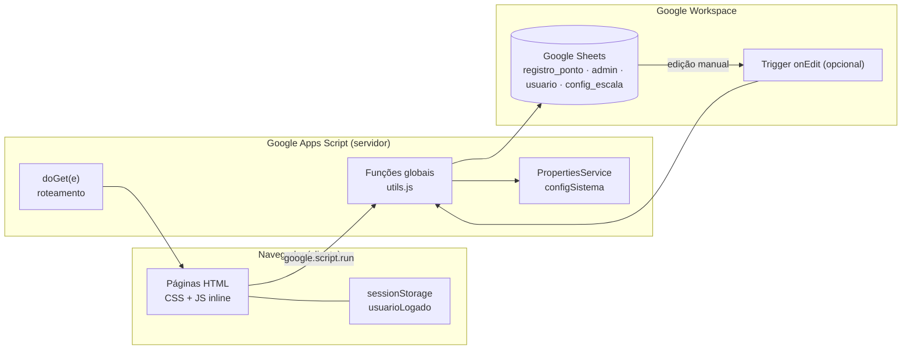
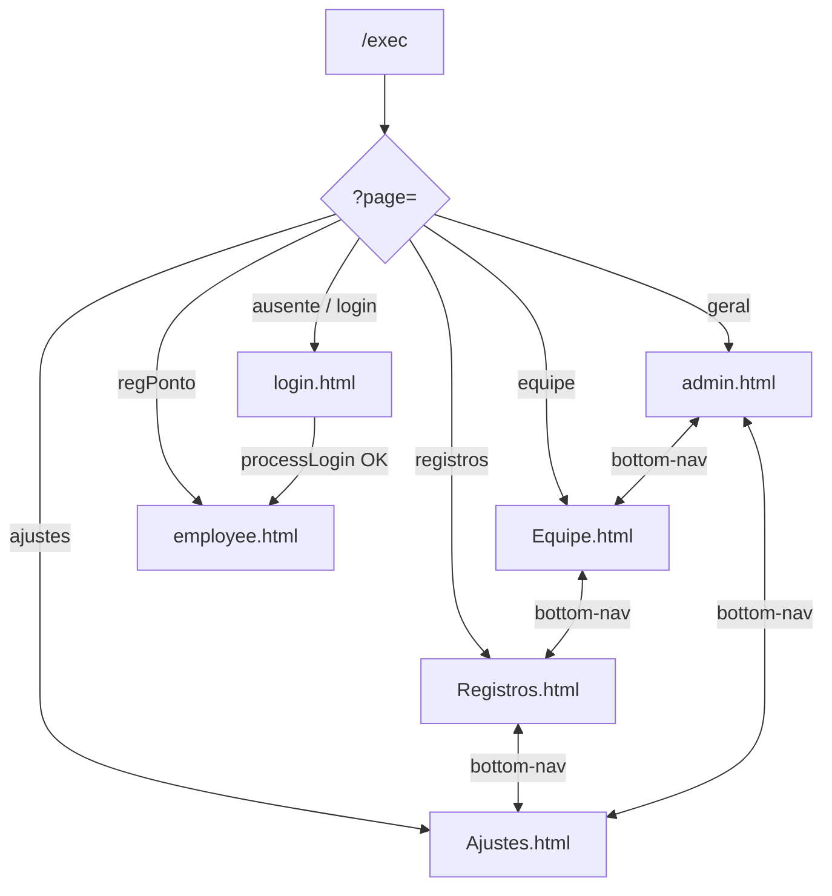
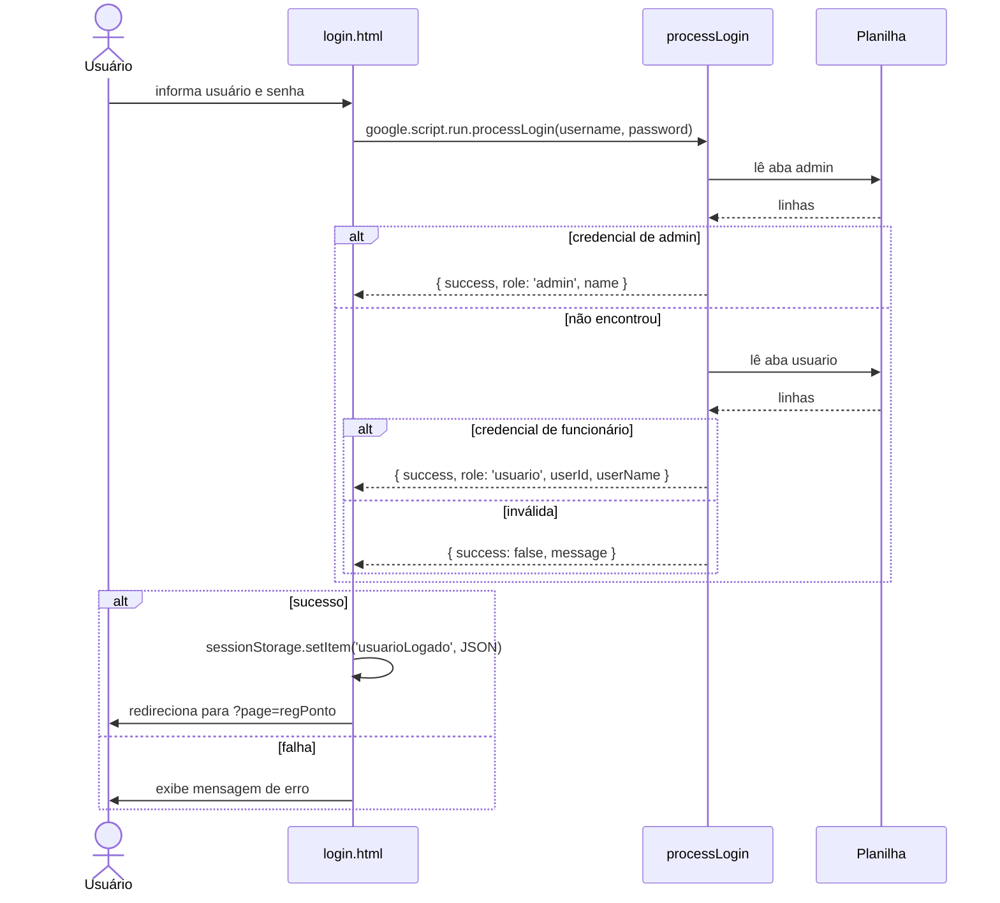
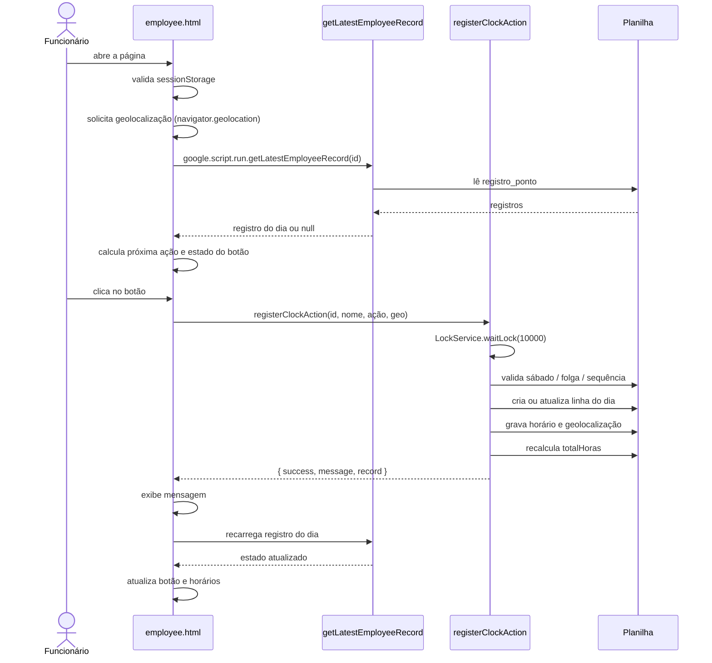
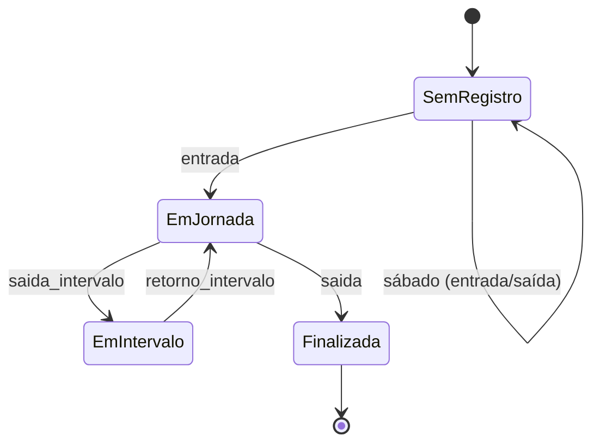
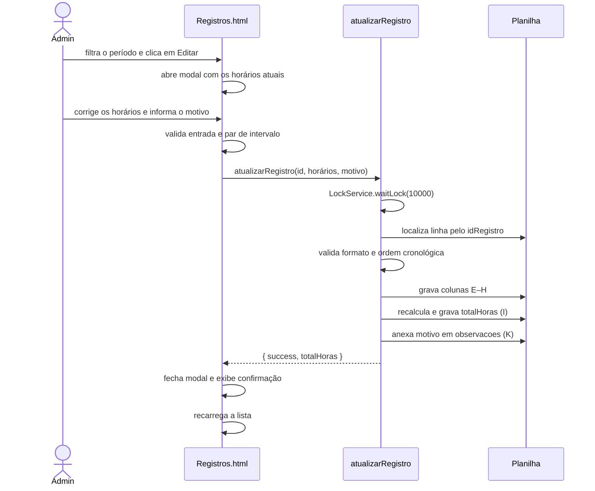
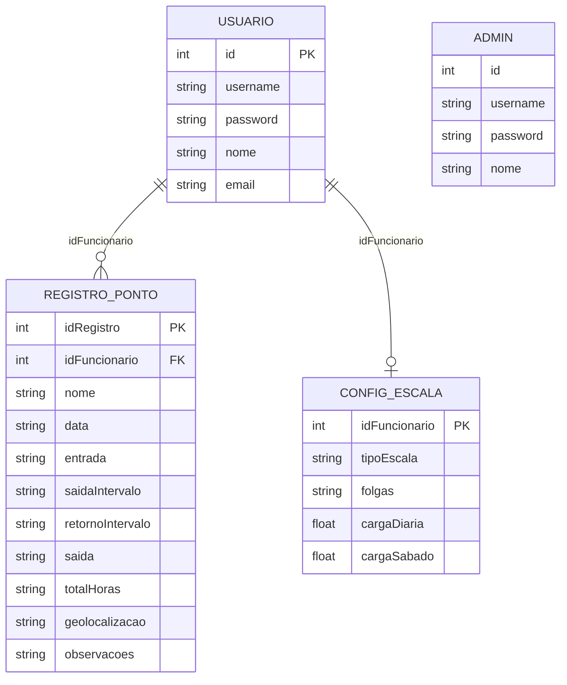

# 🏗️ Arquitetura

Documento técnico sobre como as peças do sistema se conectam, os fluxos principais e as decisões por trás do código atual.

---

## Visão em camadas

**Características:**

- Não há servidor próprio, banco relacional nem API REST.
- O "backend" é um conjunto de funções globais expostas automaticamente ao `google.script.run`.
- Toda a persistência é a planilha vinculada.
- Cada página é autocontida: CSS e JS ficam no próprio HTML, sem bundler.

---

## Fluxo de navegação

- O admin navega entre dashboard, equipe, registros e ajustes pela barra inferior.
- O funcionário fica em `employee.html`; ao sair, remove a sessão e volta ao login.
- As páginas admin **não verificam credencial no carregamento** — quem souber a URL acessa a interface (ver [Segurança](#segurança)).

---

## Fluxo de login

**Observações:**

- Admin é verificado primeiro; se as credenciais baterem, o retorno é `role: 'admin'`.
- Não há expiração de sessão nem logout no servidor.
- O redirecionamento é sempre para `?page=regPonto`, inclusive para admin (o admin volta ao dashboard pela URL `?page=geral`).

---

## Fluxo de registro de ponto

### Máquina de estados da jornada

No sábado, o fluxo é simplificado: `entrada → saida`, sem passar por intervalo.

---

## Fluxo de edição de registro (admin)

**Regras aplicadas no servidor:**

- Todos os horários precisam estar em `HH:mm` ou `HH:mm:ss`.
- Se qualquer horário for informado, a entrada é obrigatória.
- Saída e retorno do intervalo devem ser preenchidos juntos.
- Ordem: entrada < saída do intervalo < retorno < saída.
- A edição não altera nome, data ou funcionário; apenas os horários e a observação.

---

## Modelo de dados

Detalhes de colunas em [PLANILHA.md](PLANILHA.md).

---

## Decisões técnicas e trade-offs

| Decisão | Motivo provável | Consequência |
|---|---|---|
| **Sheets como banco** | Zero infraestrutura, edição manual fácil | Sem transações, leitura completa da aba, limites de tamanho |
| **HTML autocontido** | Simplicidade de deploy no Apps Script | CSS/JS duplicados entre páginas |
| **Login na planilha** | Simples de operar | Senhas em texto plano, sem auditoria |
| **`sessionStorage`** | Não depende de cookies/SSO | Sessão só no cliente; não protege o backend |
| **`LockService` só no ponto** | Evitar duplicidade no caso crítico | Escritas de escala/config podem competir |
| **Edição via sistema** | Evitar alterações soltas na planilha e manter o total consistente | Depende de a função `atualizarRegistro` validar tudo |
| **Cálculo sob demanda** | Sem jobs/planilhas auxiliares | Dashboard percorre todos os registros a cada carregamento |
| **Trigger `onEdit` opcional** | Cobertura extra para edições manuais | Não é necessário no fluxo normal |
| **Banco de horas simplificado** | Entregar visão rápida sem folha de pagamento | Não considera faltas, feriados e sábado |

---

## Concorrência

- `registerClockAction` adquire `ScriptLock` com timeout de 10s; se não conseguir, lança erro tratado no `catch`.
- O lock cobre leitura do último registro, criação/atualização da linha e recálculo.
- `atualizarRegistro` também usa `ScriptLock` (10s), cobrindo localização da linha, validação, gravação e recálculo.
- `salvarEscalaFuncionario`, `salvarConfiguracoes` e `recalcularTotalHoras` **não** usam lock.
- `onEdit` roda no contexto da edição; edições em massa podem gerar várias execuções.

---

## Tratamento de erros

- Funções chamadas pelo frontend capturam exceções e retornam `{ success: false, message }`.
- Funções de leitura retornam estruturas vazias (`[]`, `null`, objeto padrão) em vez de lançar.
- `Logger.log` é usado extensivamente; os logs aparecem em **Apps Script → Execuções**.
- O frontend usa `withSuccessHandler` e `withFailureHandler` nas operações críticas (login, registro de ponto e edição de registros).

---

## Evolução: escala 5x2, banco de horas e edição

A versão 2.0 adicionou:

1. **Aba `config_escala`** — configuração por funcionário.
2. **`isDiaFolga`** — verificação usada no registro e na UI.
3. **`onEdit` + `recalcularTotalHoras`** — consistência do total após edição manual.
4. **`calcularBancoHoras` / `getBancoHoras` / `getBancoHorasTodos`** — visão mensal.
5. **Campos no dashboard** — `cargaHorariaPrevista` e `bancoHorasTotal` (backend pronto; frontend ainda não consome).
6. **Seção de escala em Ajustes** — cadastro via formulário.

A versão 2.1 adicionou:

7. **`parseDateBR` / `formatDateBR`** — conversão de data centralizada e sem ambiguidade.
8. **Edição de registros pelo sistema** — modal em `Registros.html` + `atualizarRegistro` com validação, lock e recálculo.
9. **Registro de motivo da alteração** na coluna `observacoes`.

### Pontos de atenção da implementação

- `cargaHorariaPrevista` no dashboard soma a carga diária uma vez por funcionário.
- O banco de horas usa dias trabalhados como base de carga prevista.
- A tela de Ajustes não recarrega a escala já salva ao trocar o funcionário.
- A edição não valida o perfil do usuário no servidor.

Correções sugeridas estão no [README](../README.md#pendências-e-roadmap).

---

## Segurança

O modelo atual assume **ambiente interno e confiável**:

- `access: ANYONE` no manifesto.
- Sem validação de sessão no `doGet`.
- Sem verificação de `role` nas funções de admin.
- A UI esconde o botão de edição para não-admin, mas `atualizarRegistro` aceita chamadas de qualquer cliente que saiba o `idRegistro`.
- Senhas em texto plano.
- Geolocalização sem validação de perímetro.

Para endurecer, seria necessário:

1. Hash de senha (ex.: `Utilities.computeDigest` com salt) ou integração com Google Identity.
2. Token de sessão assinado com validade, validado em cada função.
3. Checagem de perfil nas funções administrativas, incluindo `atualizarRegistro`.
4. Restringir o acesso do Web App (`access: DOMAIN` ou `MYSELF`).

---

## Documentos relacionados

- [README](../README.md) — visão geral e operação.
- [PLANILHA](PLANILHA.md) — estrutura das abas.
- [FUNCOES](FUNCOES.md) — referência do backend.
- [CHANGELOG](../CHANGELOG.md) — histórico.
